 

<table>
<tr>
<td width="46%" align="center" valign="middle">

</td>
<td width="54%" valign="middle">

<pre>
<b>root@yerasyl:~$</b> whoami
  Yerasyl Amirtay

<b>root@yerasyl:~$</b> pwd
  Aktobe, Kazakhstan 🇰🇿

<b>root@yerasyl:~$</b> cat education.txt
  AQL IT School — 11th grade

<b>root@yerasyl:~$</b> cat focus.txt
  Websites • Apps • Backend • Cybersecurity

<b>root@yerasyl:~$</b> cat goal.txt
  Big Tech 🚀

<b>root@yerasyl:~$</b> ./status --now
  [■■■■■■■■■■] building • breaking • learning
</pre>

</td>
</tr>
</table>

 

## 🐍 &nbsp;Contribution Snake

<picture>
  <source media="(prefers-color-scheme: dark)" srcset="https://raw.githubusercontent.com/yeraruler/yeraruler/output/github-snake-matrix.svg">
  <source media="(prefers-color-scheme: light)" srcset="https://raw.githubusercontent.com/yeraruler/yeraruler/output/github-snake.svg">
  
</picture>

---

## 🛠 Tech Stack

## 🔐 Cybersecurity

## 🚀 Featured Projects

## 📊 GitHub Stats

## 📫 Contact

