 

 

<table>
<tr>
<td width="50%" align="center" valign="middle">

</td>
<td width="50%" align="center" valign="middle">

</td>
</tr>
</table>

 

### Contribution snake

---

### Stack

### Cybersecurity

### Projects

[**AinalayinAI**](https://github.com/yeraruler/AinalayinAI-) &nbsp;

[**zhasgalym.kz**](https://github.com/yeraruler/zhasgalym.kz) &nbsp;

[**Ceas-Python**](https://github.com/yeraruler/Ceas-Python) &nbsp;

### Stats

### Contact

